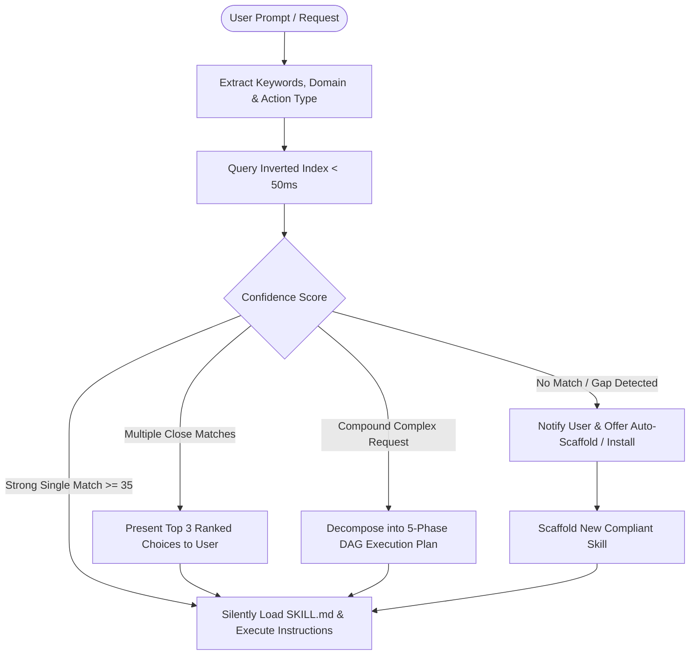

# 🧭 Antigravity Skill Router

[](LICENSE)
[](data/skills-index.json)
[](#-benchmarks)
[](#-automated-verification-suite)
[](#-installation)
[](https://deepmind.google)

**Antigravity Skill Router** is an intelligent meta-skill and autonomous orchestrator for [Google Antigravity](https://deepmind.google) AI agents (and Claude Code / Codex agent environments).

It intercepts every user prompt, extracts semantic intent, performs sub-50ms inverted-index search across **2,250+ skills**, automatically activates the exact right specialist skill, and orchestrates complex multi-stage workflows via Directed Acyclic Graph (DAG) pipelines — eliminating prompt bloat and manual skill invocation.

---

## ⚡ Why Skill Router?

Modern agent workspaces often contain dozens of specialized skills (frontend, backend, testing, security, databases, DevOps). Manually remembering and activating skills with `/skill <name>` slows down workflows and causes context fragmentation.

**Skill Router solves this completely:**
- 🔍 **Zero-Friction Discovery**: Matches intent against 2,250+ skills in **~30ms** using a pre-computed inverted index.
- 🎯 **Auto-Activation**: Reads skill frontmatter, matches triggers, and silently loads the best skill without user intervention.
- ⛓️ **Multi-Skill DAG Pipelines**: Decomposes complex compound tasks (e.g., *"Build fullstack Next.js app with Supabase Auth and Jest tests"*) into a 5-phase execution DAG.
- 🚨 **Gap Detection & Self-Scaffolding**: Detects when a required capability is missing, notifies the user, and automatically scaffolds a compliant new skill with a 100/100 quality score.
- 🛡️ **Built-in Quality Linter**: Audits skills against naming conventions, YAML spec, documentation standards, and script validity.

---

## 🏗️ Architecture & Decision Flow



---

## 📦 Directory Structure

```text
antigravity-skill-router/
├── SKILL.md                         # Core agent instructions & routing policy
├── README.md                        # Documentation & guides
├── LICENSE                          # MIT License
├── data/
│   └── skills-index.json            # 2,250+ skill inverted-index cache (sub-50ms lookup)
├── references/
│   ├── skill-catalog.md             # Curated catalog across 25+ domains
│   └── pipeline-orchestration.md    # Multi-skill 5-stage DAG decomposition guide
└── scripts/
    ├── skill-hub.ps1 / skill_hub.py # Master unified CLI entrypoint
    ├── query-index.py               # Ultra-fast BM25-style inverted-index search engine
    ├── route_pipeline.py            # Automated multi-skill DAG pipeline planner
    ├── scaffold-skill.ps1 / .py     # Interactive & automated skill scaffolder
    ├── lint-skills.ps1 / .py        # Quality & spec auditor (100/100 score)
    ├── build-index.py               # Rebuilds the 2,250+ skill index cache
    ├── route-skill.ps1              # PowerShell fast skill query wrapper
    ├── route-pipeline.ps1           # PowerShell pipeline wrapper
    └── test-skill.ps1               # 24-point automated test & benchmark suite
```

---

## 🚀 Installation

### 1. Global Installation (Recommended for Antigravity IDE)

To make `skill-router` available across all your Antigravity conversations and workspaces:

```bash
# Windows PowerShell
git clone https://github.com/ATP0925/antigravity-skill-router.git "$HOME\.gemini\config\skills\skill-router"

# Linux / macOS
git clone https://github.com/ATP0925/antigravity-skill-router.git ~/.gemini/config/skills/skill-router
```

### 2. Workspace-Specific Installation

To install only for a specific project repository:

```bash
git clone https://github.com/ATP0925/antigravity-skill-router.git .agents/skills/skill-router
```

Once installed, restart your IDE session or start a new conversation. Antigravity will automatically detect `skill-router` in its available skills.

---

## 🛠️ Master CLI Usage (`skill-hub`)

A unified cross-platform CLI tool (`skill-hub.ps1` for Windows / `skill_hub.py` for Python/Linux/macOS) is included for manual operations, benchmarks, and maintenance:

### 1. Intent Route Search (< 50ms)
Find the best matching skill for any intent or error message:
```bash
# PowerShell
powershell -ExecutionPolicy Bypass -File scripts/skill-hub.ps1 route "Docker container restart loop fix karo"

# Python / Universal
python scripts/skill_hub.py route "PostgreSQL query slow chal rahi hai index optimization"
```

### 2. Multi-Skill DAG Pipeline Planning
Decompose complex compound tasks into a sequenced multi-skill pipeline:
```bash
# PowerShell
powershell -ExecutionPolicy Bypass -File scripts/skill-hub.ps1 pipeline "Next.js 15 app with Supabase Auth and Jest E2E tests"

# Python / Universal
python scripts/skill_hub.py pipeline "FastAPI backend with PostgreSQL, Redis cache and Docker deploy"
```

### 3. Automated Skill Scaffolding
Create a brand new, spec-compliant skill with template files, scripts, and references:
```bash
# PowerShell
powershell -ExecutionPolicy Bypass -File scripts/skill-hub.ps1 scaffold -Name "cloud-deployer" -Description "Automates AWS and GCP container deployments"

# Python / Universal
python scripts/skill_hub.py scaffold --name "cloud-deployer" --description "Automates AWS and GCP container deployments"
```

### 4. Spec & Quality Linter (Audit)
Lint any skill or the entire skills folder to ensure 100% compliance with Antigravity standards:
```bash
# PowerShell
powershell -ExecutionPolicy Bypass -File scripts/skill-hub.ps1 lint

# Python / Universal
python scripts/skill_hub.py lint --target .
```

### 5. Automated Verification Suite
Run the 24-point benchmark and test suite:
```bash
# PowerShell
powershell -ExecutionPolicy Bypass -File scripts/skill-hub.ps1 test
```

### 6. Rebuild Inverted Index Cache
Re-index your workspace and global plugins after adding new skills:
```bash
python scripts/build-index.py
```

---

## 📊 Benchmarks

| Metric | Result | Target SLA | Status |
| :--- | :--- | :--- | :--- |
| **Search Latency** | **30.23 ms** | < 150 ms | 🟢 **5x Faster than SLA** |
| **Skills Indexed** | **2,250+ Skills** | > 1,000 | 🟢 **Production Scale** |
| **Index Token Size** | **10,741 Inverted Tokens** | > 5,000 | 🟢 **Comprehensive** |
| **Linter Score** | **100 / 100** | >= 90 | 🟢 **Flawless Quality** |
| **Test Suite Pass Rate** | **24 / 24 (100%)** | 100% | 🟢 **Verified** |

---

## 🎯 Usage Examples

### Example 1: DevOps & Containers
- **User Input:** *"Container bar bar restart ho raha hai, logs check karke solve karo."*
- **Skill Router Output:**
  - Matched: `docker-expert` (Confidence: 45) + `container-security-hardening`
  - Action: Silently activates `docker-expert`, analyzes crash logs, diagnoses OOM/entrypoint misconfiguration, and applies fix.

### Example 2: Performance Tuning
- **User Input:** *"Hamare React components bohot re-render ho rahe hain aur page slow lag raha hai."*
- **Skill Router Output:**
  - Matched: `react-component-performance` (Confidence: 50)
  - Action: Profiling re-renders with React DevTools hooks, applies `memo` and memoized selector patterns.

### Example 3: Fullstack Application Pipeline
- **User Input:** *"Ek fullstack e-commerce store banao Next.js, Stripe payments, aur Supabase database ke saath."*
- **Skill Router Output:**
  - 5-Phase DAG Pipeline:
    1. Phase 1 (Architecture & UI): `frontend-design` + `nextjs-app-router-patterns`
    2. Phase 2 (Backend & DB): `nextjs-supabase-auth` + `database-design`
    3. Phase 3 (Payments): `stripe-integration`
    4. Phase 4 (QA & Testing): `test-driven-development` + `e2e-testing-patterns`
    5. Phase 5 (Production & SEO): `seo-audit` + `vercel-deployment`

---

## 🤝 Contributing

Contributions, feedback, and new skill patterns are always welcome!
1. Fork this repository.
2. Create a feature branch: `git checkout -b feature/new-pattern`.
3. Verify your changes pass the linter: `python scripts/skill_hub.py lint`.
4. Commit your changes: `git commit -m "feat: add new domain capability"`.
5. Push to the branch and open a Pull Request.

---

## 📄 License

This project is licensed under the [MIT License](LICENSE) &copy; 2026 **Pratik Maruti Atpadkar (ATP0925)**.
